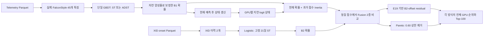

# FalconStyle 기반 GBDT–ADST–Inertia 실험 명세 v1.1

작성일: 2026-10-17  
수정: 사용자 지시에 따라 36시간 purge 적용 및 E19 기반 / 상한 없는 Pareto Fusion 비교 반영  
관련 목표: G-004, G-007, G-008  
상태: **명세 작성 완료 / 구현·학습 미실행**  
권한 범위: 사용자가 요청한 명세 문서 1개 작성. 아래 구현·실행 항목은 후속 작업의 설계다.

## 1. 목적과 사용자 지정 조건

GitHub FalconStyle의 텔레메트리 특징을 B1의 단일 GBDT에 입력한다. B1의 고정 Sliding Training(ST)과 성숙한 과거 성능 피드백에 따른 Adaptive Sliding Training(ADST)을 비교한다. B2는 Logistic Regression 하나와 고정 Sliding Training을 사용한다. Inertia는 과거 점수로부터 계산하는 추론 구성요소로 정의해 B1의 실제 예측에 반영한다. 36시간 purge를 적용하며, 동일한 분기 점수에서 E19 기반 Fusion과 0.60 상한을 제거한 Pareto Fusion을 비교한다.

| 항목 | 사용자 지정 요구 | 명세에서의 정의 |
|---|---|---|
| 기반 | GitHub FalconStyle | `ISEE_Project` 커밋 `1eac1f0edd1427bbfd3e12660917fbdb51b2a45d`의 신규 `EnhancedTelemetryEngine`을 실제 호출 |
| B1 모델 | GBDT | 단일 GBDT. Cascade·CNN·다중 모델 평균을 추가하지 않음 |
| B1 학습 | ST와 ADST 비교 | ST 7·14·21일 및 ADST 7↔14↔21일 |
| 피드백 | 성숙한 과거 성능 | 전체 라벨 기간이 종료된 과거 예측 블록만 사용 |
| B2 | Logistic 하나, ST 유지 | StandardScaler + Logistic Regression, 고정 21일 |
| Inertia | 수학적 근거를 가진 예측 구성요소 | 지연된 logit 지수평활 상태와 현재 확률의 KL 기반 결합 |
| 36시간 purge | 적용 | 학습·검증·ADST 피드백·Fusion 보정/학습의 기준 점수 시점을 origin−36시간 이하로 제한 |
| Fusion | 두 방식 비교 | E19의 B2-offset 비선형 residual 방식 / 0.60 상한 없는 Pareto 방식 |

### 1.1 명세 작성을 위해 정한 설계 기본값

다음 값은 사용자가 숫자까지 지정한 사항이 아니라 구현을 구체화하기 위한 제안값이다. 구현 전 변경하면 명세 버전과 config를 함께 갱신한다.

- B1 관측 창: 1시간 고정. 학습 창 변화와 관측 창 변화를 섞지 않는다.
- B1 구현: 기존 GPU 사용 선호에 따라 XGBoost `hist` + CUDA. GitHub의 `HistGradientBoostingClassifier`와 동일한 구현·모델을 재현한다고 표현하지 않는다.
- B2 입력: E19의 순수 XID 이력 2개를 유지한다. GitHub B2의 달력 3개 특징은 이 기본안에 포함하지 않는다.
- Inertia 적용 위치: B1의 위험 확률 산출 단계, Fusion 이전. B2에는 적용하지 않는다.
- Inertia 반감기: 2시간. 결합 강도 `gamma=1`을 사전에 고정한다.
- 실험군: 학습 정책 4개 × Inertia 2개 × Fusion 2개 = 16개. 각 Fusion 안의 주 대조는 ST21과 ADST의 2×2다.

## 2. 검증 질문과 주장 범위

1. 동일 GBDT·특징·관측 창에서 ADST가 고정 ST보다 B1 및 최종 Top-100 순위를 개선하는가?
2. 같은 원시 GBDT 점수에서 예측 단계의 Inertia가 B1 및 최종 Top-100 순위를 개선하는가?
3. ADST와 Inertia의 결합 효과가 각각의 효과보다 크거나 작은가?
4. 동일한 B1·B2 점수와 Inertia 조건에서 E19 기반 학습형 Fusion과 상한 없는 Pareto Fusion 중 어느 쪽이 유리한가?

이 실험은 모든 실험군이 두 분기를 사용하므로 Dual Branch 자체의 당위성을 입증하는 실험은 아니다. 두 Fusion은 동일한 이번 실험의 분기 점수를 공유하므로 결합 방법을 직접 비교할 수 있다. 기존 E19 전체 시스템과는 B1 특징·학습기·Inertia 적용 위치가 달라 전체 성능 차이를 Fusion만의 효과로 귀속하지 않는다. 원본 Falcon의 고장 유형별 티켓 실험 재현으로 보고하지 않는다.

## 3. 아키텍처



Inertia를 끄는 조건에서는 B1 확률이 직접 Fusion으로 들어간다. Inertia 조건에 따라 GBDT 학습이나 ADST 제어 이력이 달라지지 않도록 원시 B1 점수를 공통으로 사용한다.

## 4. 데이터·타깃·평가 모집단

- 입력 디렉터리: `E14_E19_plan_20261017/runtime/migration/data/`.
- 입력 파일: `telemetry_5m_util.parquet`, `telemetry_5m_temp.parquet`, `telemetry_5m_power.parquet`, `telemetry_5m_fb.parquet`, `xid_onsets_metadata.parquet`.
- 새 실험 시작 시 5개 파일의 SHA256과 grid 메타데이터·GPU 순서를 고정한다. 기존 raw Parquet를 수정하지 않는다.
- 타깃: 기존 E19와 같은 All-XID 24시간 inclusive-bin 라벨. 기존 ground-truth 생성 규칙과 label hash를 확인한다.
- 텔레메트리 간격: 5분. 모델 재학습 간격: 24시간. 위험 순위 생성 간격: 30분.
- 모집단: 기존 전체 1,992 GPU. XID 이력 유무로 사전 필터링하지 않는다.
- 평가 origin: 기존 64-origin 목록과 실제 유효 decision timestamp를 재사용한다. 마지막 불완전 origin을 임의로 48시점으로 늘리지 않는다.
- 특징 시점: 예측 시점 직전 10분 구간 제외. 기존 추출기의 최소 lag는 5분 격자에서 15분이므로 실제 마지막 관측 시각도 저장한다.
- 데이터 끝에서 24시간 라벨을 확인할 수 없는 행은 기존 GT 유효성 규칙대로 처리하고, 정상 음성으로 새로 채우지 않는다.

현재 64-origin 기간은 이미 분석한 개발 기간이다. 이 결과를 새 독립 테스트 성능으로 표현하지 않는다.

## 5. 36시간 purge와 라벨 성숙

예측 시점을 `s`, 모델 재학습 origin을 `O`, 예측 horizon을 `H=24h`, purge 간격을 `P=36h`라고 한다. 학습·검증·피드백·Fusion 학습에 사용할 행은 다음 두 조건을 모두 만족해야 한다.

\[
s\le O-P,\qquad s+H\le O.
\]

학습 창 길이가 `L`일이면 기본 학습 구간은 다음 반개구간이다.

\[
[O-P-L,\ O-P).
\]

명세 파라미터는 `purge_hours=36`, `label_horizon_hours=24`, `label_maturity_hours=24`다. purge 36시간에는 24시간 라벨 성숙과 추가 12시간 간격이 포함되며, 둘을 더해 60시간을 제외하지 않는다. 실제 마지막 학습 시각·라벨 종료 시각·기준 origin·유효 간격을 manifest에 기록한다.

이 시간 조건은 B1·B2 학습과 검증, ADST 성능 피드백, E19 기반 Fusion의 calibration·residual 학습에 공통 적용한다. 양성은 일찍 관측되더라도 양성·음성 모두 동일한 성숙·purge 조건을 적용한다. 현재 예측용 텔레메트리·XID 이력의 10분 차단과 과거 점수만 사용하는 Inertia 상태는 각각의 인과적 입력 규칙을 유지하며, 그 입력을 추가로 36시간 지연시키지 않는다.

ADST는 해당 과거 블록의 **마지막 예측 시점 ≤ O−36시간**이고 모든 라벨이 성숙한 뒤 블록 전체를 한 번만 처리한다. 하루에 48개 시점을 예측한 블록은 일일 재학습 격자에서 통상 origin으로부터 사흘 뒤 피드백에 편입된다. 데이터 수집 지연을 0으로 가정한 설계이며 실제 라벨 도착 지연이 확인되면 별도 파라미터로 추가한다.

## 6. B1 특징 및 모델

### 6.1 실제 신규 FalconStyle 추출기 연결

신규 `ML/branch1_enhanced_features.py:EnhancedTelemetryEngine.extract_branch1_features` 경로를 호출한다. 기존 결과 CSV가 사용한 `30+7+8` 특징과 구분한다.

| 특징군 | 개수 | 정의 |
|---|---:|---|
| 기본 텔레메트리 통계 | 22 | 4개 지표 × last/mean/std/delta 16개 + node context 6개 |
| 교차 지표 | 7 | GitHub 신규 모듈의 명시된 교차 수식 |
| 노드 상대 통계 | 8 | 온도·전력·사용률의 이웃 통계 |
| Peer 상대 특징 | 5 | 온도·전력·사용률 z-score 3개, 온도·전력 rank 2개 |
| 시간 특징 | 3 | 온도·전력 slope 2개, thermal_persistence 1개 |
| 합계 | **45** | 전체 열 이름·순서·수식 버전을 저장 |

- B1에 XID 이력·현재 라벨·미래 관측·전체 기간 집계 통계를 넣지 않는다.
- 노드 통계는 기존 코드의 `gpu_idx // 8` 그룹 가정이다. 실제 host/task 매핑으로 검증된 peer라고 주장하지 않는다.
- `thermal_persistence`는 `(last-mean)/std`이며 온도 임계 초과 지속시간이 아니다. 고정 관측 창에서는 slope와 delta에 중복 정보가 존재한다.
- 결측 처리와 `_safe_ratio`의 0 대체·범위 제한을 소스대로 고정한다. 새로운 보간 또는 결측 특징을 이번 명세에 임의로 추가하지 않는다.
- 이 모델은 tabular 45개 특징만 사용한다. 호출 경로에서 불필요한 CNN tensor를 만들지 않도록 인터페이스를 분리할 수 있으나 표 특징 값은 같아야 한다.

### 6.2 GBDT 기본값

| 파라미터 | 값 |
|---|---|
| 구현 | XGBoost, `tree_method=hist`, `device=cuda` |
| objective | `binary:logistic` |
| n_estimators | 150 |
| max_depth | 6 |
| learning_rate | 0.06 |
| reg_lambda | 1.5 |
| min_child_weight | 1 |
| subsample / colsample_bytree | 1.0 / 1.0 |
| seed | 20260905를 기준으로 한 고정 seed 체계 |
| 하이퍼파라미터 선택 | 이번 16개 비교군에 공통 고정, 테스트 성능으로 재선택하지 않음 |

위 값은 GitHub sklearn HGB 파라미터와 동등하다는 뜻이 아니다. 사용자가 sklearn HGB 자체를 지정하면 backend와 명세 버전을 바꾸고 모든 비교군에 동일하게 적용한다. CUDA 실패 시 임의 CPU fallback 결과를 같은 run으로 이어 붙이지 않는다.

## 7. B2 모델 및 학습 표본·확률 보정

### 7.1 B2

- 입력: `xid_count_30d`, `days_since_xid`.
- 예측 시점 10분 전까지의 XID 이력을 사용한다. 과거 이력이 없으면 count는 0, days_since는 기존 규칙인 90일을 사용한다.
- 모델: StandardScaler + `LogisticRegression(max_iter=250, class_weight=balanced)`.
- 학습 창: 21일. 재학습: 24시간. 라벨 성숙 조건은 B1과 동일하다.
- B2용 GBDT와 달력 특징, B2 Inertia를 추가하지 않는다.

### 7.2 표본과 자연 양성률 복원

학습 창의 양성 행 전체와 균등 무작위 음성 표본을 사용한다. 음성 수는 `min(10 × 양성 수, 200000)`으로 제한한다. 동일 origin·창·데이터·seed 조합의 표본을 모든 해당 비교군에서 공유한다. 자연 양성률은 샘플이 아닌 **해당 성숙한 전체 학습 구간**으로 계산한다.

GBDT의 클래스 보정은 `scale_pos_weight=N_negative/N_positive`, Logistic은 `class_weight=balanced`로 정의한다. 추가적인 역표집 가중치를 중복 적용하지 않는다. 유효 학습 prior를 `pi_eff`, 자연 학습 prior를 `pi_nat`이라고 하면 Fusion 이전 확률은 다음과 같이 복원한다.

\[
\operatorname{logit}(p^{natural})
=\operatorname{logit}(p^{raw})
-\operatorname{logit}(\pi_{eff})
+\operatorname{logit}(\pi_{nat}).
\]

클래스 균형 가중치를 적용한 이 설계에서 `pi_eff=0.5`다. 기존 함수에 단순 표본 양성률을 넣어 가중치와 확률 복원을 이중 적용하지 않는다. 이는 case-control 표집·prior shift 가정의 보정이며 완벽한 확률 calibration이나 순위 개선을 보장하지 않는다. B1·B2별 학습 창의 `pi_nat`를 각각 저장한다.

양성 또는 음성이 없는 창에서는 해당 전체 학습 창의 양성률에 작은 수치 clipping을 적용한 상수 예측을 내고 `constant_fallback`으로 기록한다.

## 8. B1 학습 정책: ST와 성숙 피드백 ADST

### 8.1 고정 Sliding Training

ST7, ST14, ST21은 창 길이를 각각 7·14·21일로 고정한다. 세 조건 모두 매일 재학습한다. ADST와 재학습 주기·특징·표본 추출·GBDT 설정이 같다. ST21을 주 기준선으로 두고 ST7·ST14를 고정 창 민감도 비교에 사용한다.

### 8.2 ADST 제어 규칙

기존 E14 계열의 성숙 피드백 제어기를 단일 GBDT에 이식한다. GitHub의 관측 창 탐색·momentum 제어기와 구분한다.

- 후보 창: `[7,14,21]`일. 초기 창: 14일.
- 감소 임계값: 0.15. 안정 블록 누적 3회에 한 단계 확장.
- 피드백 대상: Inertia 적용 이전 B1 확률의 과거 블록 성능. 현재/미래 테스트 성능으로 창을 고르지 않는다.
- 블록 피드백 AP는 해당 origin의 유효 30분 query별 AP 평균으로 정의하고, 양성 없는 query는 AP=0으로 포함한다. 블록 prevalence는 전체 유효 행의 양성률이다. 보고용 origin 전체 행 AP와 서로 다른 집계이므로 별도 열로 저장한다.
- 정규화 성능은 `nAP=clip((AP-prevalence)/max(1-prevalence,1e-8),0,1)`로 정의한다.
- 기존 함수의 집계를 유지한다. 현재 성숙 블록을 포함한 최근 최대 4개 nAP 평균을 R, 그보다 앞선 최대 3개 평균을 P라 한다. P 구간이 없으면 drop=0이다. 그렇지 않으면 `drop=max(0,(P-R)/max(abs(P),1e-4))`다.
- `drop>=0.15`: 창을 한 단계 축소하고 stable_count=0. 이미 7일이면 유지한다.
- 그 외: stable_count를 1 증가시킨다. 3회 이상이며 현재 창이 21일 미만이면 한 단계 확장하고 stable_count=0. 나머지는 유지한다.
- 같은 성숙 블록은 한 번만, 오래된 순서로 처리한다. 이번 origin에서 처리한 결과를 이번 재학습 창에 반영한다.
- 성숙한 피드백이 없으면 초기 14일을 유지한다. 표본 부족시 기존 fallback을 기록하며 창을 사후 탐색하지 않는다.

`rescan`이라는 로그 이름을 사용하더라도 실제 후보 3개를 다시 fit하지 않았다면 탐색했다고 기록하지 않는다. 이번 설계는 성능 피드백에 따라 한 단계 이동하는 제어기다. 현재 origin의 세 ST 모델 결과가 계산되어 있어도 ADST는 그 테스트 지표를 열람하지 않는다.

## 9. 수학적 근거를 가진 Inertia 추론 모듈

### 9.1 설계 의도와 출처

GBDT에서 자연 prior로 보정한 현재 확률을 `p(g,t)`, logit을 `z(g,t)`라 한다. 과거 logit을 지수평활해 현재 시점의 시간적 참조분포를 구성하고, 현재 분포와 참조분포 사이의 KL 목적함수를 최소화한다.

지수평활의 재귀식과 감쇠 가중치는 Hyndman·Athanasopoulos의 교재에 근거한다. 확률분포의 log pooling은 Heskes의 선행연구와 KL 기반 opinion pooling 문헌에 근거한다. **이 둘을 B1 추론에 결합하는 구체적인 방식은 이번 명세의 설계안**이며 해당 문헌이 GPU 위험 예측 성능이나 이 파라미터의 최적성을 입증한 것은 아니다.

### 9.2 현재 점수를 넣기 전의 과거 상태

반감기 `h=2h`, 기본 판단 간격 `delta=0.5h`에서 유지 계수는 다음과 같다.

\[
\rho=2^{-\delta/h}=2^{-0.25}\approx0.840896.
\]

현재 시점 이전에 저장된 상태를 `m(g,t-)`라고 하고, 참조 확률을 다음과 같이 둔다.

\[
r(g,t)=\sigma(m(g,t-)).
\]

현재 예측을 완료한 **뒤** 다음 시점용 상태를 갱신한다.

\[
m(g,t)=\rho m(g,t-)+(1-\rho)z(g,t).
\]

시점 간격이 달라지면 실제 경과 시간으로 rho를 계산한다. 최초 시점이나 상태 복구가 불가능한 경우는 `q=p`로 예측하고 해당 raw logit으로 상태를 초기화한다. 24시간 이상 예측 공백이 있으면 상태를 재초기화하고 이유를 기록한다.

모델을 매일 재학습해도 과거에 실제 생성한 점수 상태를 이어받는다. 새 모델로 과거 점수를 재계산해서 기억을 덮어쓰지 않는다. raw B1 점수로 상태를 갱신하고 Inertia 적용 결과 q를 다시 입력하지 않는다.

### 9.3 KL 정규화에 의한 현재 예측

Inertia를 켠 조건의 B1 예측 q는 다음 최적화의 해다.

\[
q^*=\arg\min_{0<q<1}\left[
D_{KL}(Bern(q)\Vert Bern(p))
+\gamma D_{KL}(Bern(q)\Vert Bern(r))
\right],\qquad\gamma=1.
\]

q에 대한 1차 미분을 0으로 두면 다음 닫힌 해를 얻는다.

\[
(1+\gamma)\operatorname{logit}(q)
=\operatorname{logit}(p)+\gamma\operatorname{logit}(r),
\]

\[
\boxed{q=\sigma\left(\frac{z+\gamma m_{t-}}{1+\gamma}\right)}.
\]

목적함수의 2차 미분은 `(1+gamma)/(q(1-q))>0`이므로 내부 해는 유일하다. gamma=0이면 원시 B1 확률이 복원된다. 이 유도는 명세의 Bernoulli 두 분포 결합에 대한 직접 계산이다.

현재 확률과 과거 확률은 상관된 추정치다. 이를 독립 관측 두 개로 가정한 Bayesian posterior라고 표현하지 않는다. 이 목적함수의 해가 유일하다는 사실은 AP·Recall@100의 향상을 보장하지 않는다. 급격한 위험 상승에서는 반응 지연을 만들 수 있으므로 선행 시간과 새 XID 위험 포착도 함께 평가한다.

### 9.4 모델에 결합하는 위치

전체 B1 predictor는 `GBDT + prior restoration + causal Inertia inference`로 정의한다. q가 매 시점 Fusion과 순위를 실제로 바꾸며, 모든 timestamp의 raw 점수·지연 상태·q를 저장한다. 평가 종료 후 좋은 기간만 골라 점수를 수정하는 분석으로 대체하지 않는다.

이 설계에서 GBDT 학습 목적함수는 기존 binary log-loss다. **Inertia를 GBDT 학습 손실에 추가한 모델이나 end-to-end 재학습으로 표현하지 않는다.** 학습 손실 자체에 temporal penalty를 넣는 방식은 별도 모델 변경이다.

## 10. Fusion 두 방식 비교

두 방식은 동일한 B1 입력 `q_B1`과 B2 입력 `p_B2`를 사용한다. Inertia off에서는 `q_B1=p_B1`이다. 분기 점수·학습 정책·시점·모집단을 고정한 채 Fusion 종류만 바꿔 비교한다.

### 10.1 Pareto Fusion: 0.60 상한 제거

일일 origin O의 직전 10분 이전까지, 최근 30일 XID 횟수를 `k(g,O)`로 계산한다. 해당 origin의 판단 구간에서는 가중치를 고정한다.

\[
\lambda(g,O)=\frac{1}{k(g,O)+1},
\]

\[
p_F(g,t)=\lambda(g,O)q_{B1}(g,t)
+(1-\lambda(g,O))p_{B2}(g,t).
\]

- alpha=1.0을 유지하고, 기존 cap=0.60 제한을 제거한다. 설정은 `fusion_cap=null`이다. 확률 가중치의 자연 범위는 0~1이다.
- XID 이력이 없으면 k=0이므로 lambda=1, 즉 B1만 사용한다. 이력이 1회면 lambda=0.5다. 이러한 가중치 변화도 평가에 포함한다.
- 기준은 **보고 CSV를 만든 scratch 실행기**에서 0.60 상한만 제거한 수식이다. 이 식에는 0.05 하한이 없다. 다른 `pareto_lambda` helper의 0.05 clipping을 자동 승계하지 않는다.
- Fusion용 XID count는 scratch의 origin cutoff·좌우 경계 규칙을 보존하고 저장한다. query마다 가중치를 재계산하는 새 정책으로 변경하지 않는다.
- 전체 1,992 GPU에 대해 Fusion한 뒤 정렬하여 Top-100을 구한다. 분기별 Top-100만 합치지 않는다.

### 10.2 E19 기반 Fusion

E19의 확률 calibration과 **B2-offset 비선형 residual**을 이번 실험의 동일 분기 점수에 적용한다. 입력은 `q_B1`, `p_B2`이며 각각 보정한 확률을 `c1`, `c2`라 한다.

\[
\operatorname{logit}(p_E)=\operatorname{logit}(c_2)+\phi(c_1,c_2)^T\beta,
\]

\[
z_j=\operatorname{logit}(c_j)/6,\qquad
\phi=[1,z_1,z_2,z_1^2,z_2^2,z_1z_2].
\]

- 재학습 origin O에서 `C=O−36h`로 두고, `[C−14일,C−7일)`의 과거 예측으로 두 입력의 calibration을 학습한다. `[C−7일,C]`의 별도 과거 예측으로 residual을 학습한다.
- 원본 E19의 `fitted_calibrator`, `fitted_residual`, 최소 양성/음성 수 20, L2 정규화 0.01 및 최적화 설정을 기준으로 한다. 입력 점수는 과거 시점에 실제 생성한 순차 예측을 사용하며 현재 모델의 학습 표본 내 점수로 대체하지 않는다.
- B1 Inertia는 9절에서 이미 예측에 반영한다. E19 원본의 별도 B1/B2 Inertia 입력을 추가하지 않아 같은 관성을 두 번 넣지 않는다. 따라서 이 조건은 **이번 분기 점수에 적용한 E19 기반 Fusion**이며 원본 E19 Dual-Inertia의 완전 동일 재현은 아니다.
- Inertia on/off별 과거 입력이 다르므로 각 조건에 맞는 calibration과 residual을 따로 학습한다. ST/ADST 정책별 과거 점수도 서로 섞지 않는다.
- 14일 점수 이력이 부족하거나 calibration/Fusion 구간의 최소 클래스 수를 충족하지 못하면 원본 E19처럼 B2로 fallback하고 이유를 기록한다.
- 두 방식 모두 전체 GPU를 Fusion한 뒤 Top-100을 산출한다. 전체 운영 기간의 fallback 포함 평가와, E19 기반 Fusion이 학습 가능한 공통 origin만의 비교를 함께 보고한다.

## 11. 실험군과 계산 재사용

| 기본 ID | B1 학습 정책 | B1 Inertia | B2 | Fusion별 실행 ID |
|---|---|---|---|---|
| S7-0 | ST7 | 끔 | LR / ST21 | S7-0-P / S7-0-E |
| S7-I | ST7 | 켬 | 동일 | S7-I-P / S7-I-E |
| S14-0 | ST14 | 끔 | 동일 | S14-0-P / S14-0-E |
| S14-I | ST14 | 켬 | 동일 | S14-I-P / S14-I-E |
| S21-0 | ST21 | 끔 | 동일 | S21-0-P / S21-0-E |
| S21-I | ST21 | 켬 | 동일 | S21-I-P / S21-I-E |
| A-0 | ADST | 끔 | 동일 | A-0-P / A-0-E |
| A-I | ADST | 켬 | 동일 | A-I-P / A-I-E |

`-P`는 상한 없는 Pareto, `-E`는 E19 기반 Fusion이다. 총 16개 조건이다. 각 Fusion 안에서 S21-0 / S21-I / A-0 / A-I를 주 대조로 삼고, 같은 기본 ID의 P/E를 직접 비교한다. ST7·ST14 결과를 통해 ADST의 이득이 단지 ST21의 부적절한 창 길이 때문인지 확인한다. 테스트 성능으로 고른 가장 좋은 고정 창은 사후 참고치로만 표시한다. 실제 선택 가능한 고정 창 기준선은 평가 이전 검증에서 선택하고 고정해야 한다.

동일 origin·학습 창·특징·표본·모델 설정의 GBDT fit과 원시 점수는 공유할 수 있다. Inertia on/off는 같은 점수를 사용한다. ADST가 같은 origin에서 ST의 특정 창을 택했다면 그 모델을 재사용한다. B2는 전체 실험군에서 동일한 점수를 공유한다. 이때 현재 테스트 지표가 ADST 선택기로 전달되지 않도록 접근 경계를 둔다.

64 origins 전체에서 캐시가 정확히 공유되면 최대 B1 `3×64=192`회, B2 `64`회의 기본 fit으로 구성할 수 있다. Fusion 2종은 분기 모델을 공유하므로 B1·B2 재학습 횟수를 두 배로 늘리지 않는다. E19 기반 방식의 calibration·residual fit은 학습 가능한 origin과 8개 기본 조건별로 추가 집계한다. fallback·재시도·외부 검증용 fit이 생기면 별도 집계한다. GPU GBDT 학습은 기본적으로 한 프로세스씩 수행하고, 특징·Inertia·Fusion 계산은 chunk 단위로 처리한다.

## 12. 평가·해석·E19 비교

- 주 평가: origin 전체 행으로 계산한 AP의 origin 평균. origin마다 동일 가중치를 준다.
- 핵심 순위 평가: 매 30분 시점 Top-100의 Precision@100, Recall@100, NDCG@100. pooled 값과 시점·origin 평균을 구분한다.
- 통계: 동일 timestamp·GPU·라벨의 paired 차이, 날짜별 승/패/동률, 3일·7일 moving-block bootstrap 95% 구간. 양쪽 조건의 행 집합을 먼저 일치시킨다.
- 상호작용: 각 Fusion 안에서 지표 M에 대해 `(M_A-I-M_A-0)-(M_S21-I-M_S21-0)`를 함께 보고한다. 동일 기본 조건의 `M_E−M_P`로 Fusion 차이도 보고한다.
- Inertia 부작용: 목록 turnover, 새롭게 등장한 고위험 GPU 진입 지연, 고유 XID onset 포착률·선행 시간. 사건 기준의 유효 관측 범위와 중복 처리 규칙을 별도 명시한다.
- 각 표에 전체 행 수, 양성 수, 자연 양성률, GPU 수, 유효 시점 수를 표시한다. GPU-time 적중을 고유 오류 사건 수로 표현하지 않는다.
- 시간: 데이터 로딩·특징·모델 fit·예측·Inertia·Fusion·저장 시간을 분리한다. 동일 조건의 실측 GPU 시간과 wall time을 보고한다.

기존 E19와 이번 실험은 36시간 purge를 공통 적용한다. 다만 기존 E19 전체 시스템과는 B1 특징·학습기·Inertia 적용 위치가 다르므로 기존 저장 점수는 같은 timestamp에 정렬한 **시스템 단위 참고 비교**로 표시한다. 이번 실험의 P/E 비교는 동일 분기 점수에서 Fusion만 바꾼 대조이며, 원본 E19 전체를 같은 조건으로 재학습한 결과와 구분한다. Fusion 비교는 fallback을 포함한 전체 기간과 E19 기반 방식의 학습 가능 공통 기간을 모두 보고한다.

ADST·Inertia·전체 조합의 향상 여부는 결과로 판단한다. 설정값의 수학적 정의나 이론적 정당성을 근거로 성능 향상을 미리 확정하지 않는다.

## 13. 구현 인터페이스·증거·완료 조건

후속 구현은 별도 실험 폴더에서 다음 논리 구성으로 진행한다. 아래 파일은 이번 명세 작성에서 생성하거나 실행하지 않는다.

```text
FalconStyle_GBDT_ADST_Inertia/
  config.json
  ML/run_experiment.py
  runs/<run_id>/
    manifest.json
    feature_manifest.json
    fit_trace.jsonl
    adst_feedback.csv
    state/checkpoint.*
    scores/<policy>/origin_*.parquet
    metrics_by_origin.csv
    comparison.json
    fidelity_audit.json
```

주요 설정 키는 `purge_hours=36`, `label_maturity_hours=24`, `b1_observation_hours`, `gbdt_backend`, `b2_feature_set`, `b2_train_days`, `adst_initial_days`, `adst_drop_threshold`, `adst_stable_blocks`, `inertia_half_life_hours`, `inertia_gamma`, `fusion_kinds=[pareto_uncapped,e19_residual]`, `fusion_cap=null`, `fusion_alpha=1`, `fusion_lambda_floor=null`, `e19_calibration_days=7`, `e19_fusion_days=7`, `e19_regularization=0.01`다.

각 score 행에는 timestamp·GPU-ID·label·raw B1·보정 B1·과거 memory의 값/최종 시각·Inertia B1·B2·Fusion 종류·Pareto lambda(해당 방식만)·최종 점수·순위·학습 창·모델 버전을 남긴다. E19 기반 방식에는 calibration/residual 버전·학습 cutoff·trained/fallback 상태를 함께 남긴다. off/on 비교군을 공통 raw score와 상태 정보로 재구성할 수 있어야 한다.

실행 완료 판정은 다음 증거가 모였을 때 한다.

1. 실제 호출된 신규 45열 feature manifest, 코드 SHA256, 입력 SHA256.
2. B1·B2·검증·ADST·E19 기반 Fusion의 학습용 행 시점이 origin−36시간 이하이며, 모든 라벨 성숙 시각이 재학습 origin 이하라는 감사 결과.
3. Inertia 예측에 사용한 상태의 마지막 관측 시각이 현재 예측 시점보다 과거라는 감사 결과.
4. gamma=0 조건에서 보정 B1이 복원되고, 예측 후에만 상태가 갱신된다는 확인.
5. 전체 GPU coverage와 중복 없음, label hash, 결정 시점 수, score에서 재계산한 지표 일치.
6. ADST 상태 전이와 실제 학습 창 변경의 연결, 처리한 피드백 ID 중복 없음.
7. CUDA 학습 backend의 실제 실행 trace. CPU 처리 구간은 따로 기록.
8. 16개 비교군의 동일 평가 집합, 실패·fallback·resume 기록 및 최종 미완료 범위. Pareto 상한 제거와 E19 기반 방식의 별도 calibration·residual fit 증거.

36시간 purge 또는 라벨 성숙 위반·미래 메모리 참조·다른 특징 추출기 호출·GPU coverage 누락·의도하지 않은 Fusion 변경·백엔드 임의 교체가 있으면 성능 비교를 중단하고 원인과 부분 산출물을 보존한다.

### 13.1 요구사항 추적 매트릭스

모든 행의 상태는 후속 실행 전 `planned`다.

| ID | Source / section | Intended behavior | Planned implementation | Code / symbol | Config | Runtime evidence | Output | Status | Deviation / consequence | Next action |
|---|---|---|---|---|---|---|---|---|---|---|
| R1 | 사용자·GitHub 신규 모듈 | 실제 FalconStyle 특징 | 신규 45열 추출기 연결 | `EnhancedTelemetryEngine.extract_branch1_features` | feature version | 호출·열 trace | feature_manifest | planned | 보고 CSV의 기존 45열과 다름 | 구현 |
| R2 | 사용자 GBDT | 단일 B1 모델 | CUDA XGBoost | 새 `fit_b1` 예정 | gbdt_backend | fit/backend trace | fit_trace | planned | sklearn HGB와 구현 차이 | 구현 |
| R3 | 사용자 ST/ADST·E14 제어기 | 성숙 피드백 창 조정 | ST 3개 + 단계 이동 제어 | 새 `update_adst` 예정 | candidates, thresholds | 성숙·전이 trace | adst_feedback | planned | Cascade 대신 GBDT | 구현 |
| R4 | 사용자 B2 | LR 하나/ST21 | 이력 2열 Logistic | 새 `fit_b2` 예정 | b2_feature_set | 입력·fit trace | manifest, scores | planned | 달력 3열 제외는 기본 해석 | 구현 전 설정 고정 |
| R5 | 사용자 Inertia·수학 문헌 | 예측에 시간 상태 반영 | 지연 EWMA + KL 해 | 새 `predict_with_inertia` 예정 | h=2h, gamma=1 | 예측/갱신 시각 | scores, checkpoint | planned | GBDT 학습 손실 변경 아님 | 구현 |
| R6 | 사용자 36h 적용 | purge와 성숙 라벨 | purge36h + maturity24h | 새 `eligible_training_rows` 예정 | purge_hours=36 | cutoff/label-end audit | fidelity_audit | planned | 기존 E19와 purge 동일 | 구현 |
| R7-P | 사용자 Pareto 상한 제거 | 규칙 기반 Fusion | alpha1/no cap/no floor | 새 `pareto_fusion` 예정 | cap=null | lambda 재계산 | scores, audit | planned | k=0일 때 B1 가중치1 | 구현 |
| R7-E | 사용자 E19 기반 비교 | 학습형 Fusion | B2-offset/이차 residual/7+7일 | 새 `e19_residual_fusion` 예정 | cutoff=O−36h | calibration/residual trace | scores, audit | planned | Inertia는 공통 B1 추론에 적용 | 구현 |
| R8 | 사용자 비교 목적 | 16개 조건 동일 평가 | 같은 raw score·B2 재사용 | 새 `evaluate` 예정 | 16 arms | coverage/hash/metrics | comparison | planned | 현재 개발 기간의 실험 | 실행 후 판정 |

## 14. 근거와 버전

1. GitHub 기준 커밋: [1eac1f0](https://github.com/zzzaaanew/ISEE_Project/commit/1eac1f0edd1427bbfd3e12660917fbdb51b2a45d).
2. 실제 연결할 신규 특징 모듈: [branch1_enhanced_features.py](https://github.com/zzzaaanew/ISEE_Project/blob/1eac1f0edd1427bbfd3e12660917fbdb51b2a45d/ML/branch1_enhanced_features.py).
3. Pareto Fusion 기준: [scratch_compute_all_origins_top100.py](https://github.com/zzzaaanew/ISEE_Project/blob/1eac1f0edd1427bbfd3e12660917fbdb51b2a45d/scratch_compute_all_origins_top100.py)의 수식에서 사용자 지시로 0.60 상한을 제거한다. E19 기반 Fusion 기준: [run_experiment19_30m_dual_inertia_fusion.py](https://github.com/zzzaaanew/ISEE_Project/blob/1eac1f0edd1427bbfd3e12660917fbdb51b2a45d/experiments/2026-10-06_Experiment19_DualInertiaFusion_GitArchive_01/ML/run_experiment19_30m_dual_inertia_fusion.py)의 calibration·B2-offset residual.
4. ADST 제어기 기준 로컬 코드: `E14_E19_plan_20261017/runtime/migration/e19-reproduction-gpu-opt/ML/run_experiment11_30m_han_adst_b1_light_cascade_b2_sliding.py:_safe_norm_ap,_update_adst_from_cycle` 및 `run_experiment14_30m_matured_adst_moe.py:_flush_matured_adst`.
5. 지수평활의 근거: Hyndman & Athanasopoulos, [Forecasting: Principles and Practice, Chapter 8](https://otexts.com/fpp3/exponential-smoothing.html). logit 점수에 적용하는 것은 이번 설계의 이식이다.
6. 확률 log pooling의 근거: Tom Heskes, [Selecting Weighting Factors in Logarithmic Opinion Pools, NIPS 1997](https://papers.neurips.cc/paper_files/paper/1997/hash/59f51fd6937412b7e56ded1ea2470c25-Abstract.html).
7. KL 기반 pooling의 문헌: Sečkárová, [Performance of Kullback-Leibler Based Expert Opinion Pooling for Unlikely Events, PMLR 58, 2017](https://proceedings.mlr.press/v58/seckarova17a.html). 해당 문헌의 별도 KL-pool을 이번 모델에 구현한다는 뜻은 아니다.

## 15. 승인 범위와 남은 결정

명세 문서 작성은 이번 요청으로 수행했다. 학습 실행·실험 코드 변경·기존 실행 중단·환경 설치·Git commit/push는 이번 명세 작성의 범위에 포함하지 않는다.

구현 시 고정할 해석은 1.1의 기본값이다. 특히 **Fusion=E19 기반 residual / 상한 없는 Pareto 비교**, **GBDT 구현=XGBoost CUDA**, **B2 입력=이력 2열**, **Inertia=학습 손실 변경이 아닌 공통 B1 추론 구성요소**, **36시간 purge 적용 + 24시간 라벨 성숙 확인**을 구현 계획에 그대로 명시한다. 이번 수정은 purge·Fusion과 그에 따른 비교군·감사 항목에 한정한다. 이 해석 중 하나가 바뀌면 동일한 실험으로 간주하지 않고 명세를 갱신한다.
